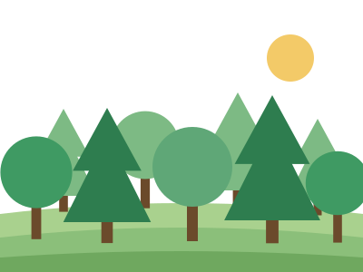
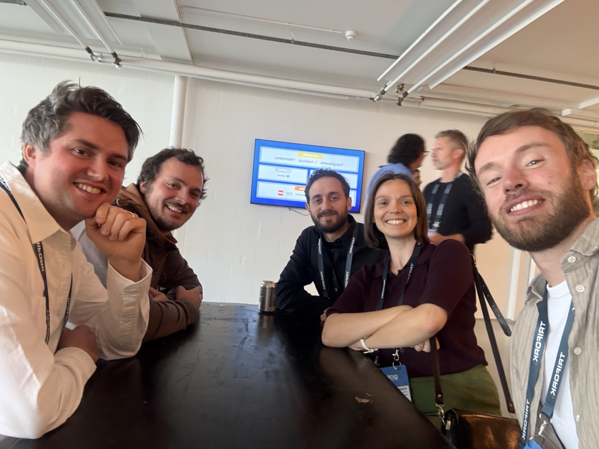
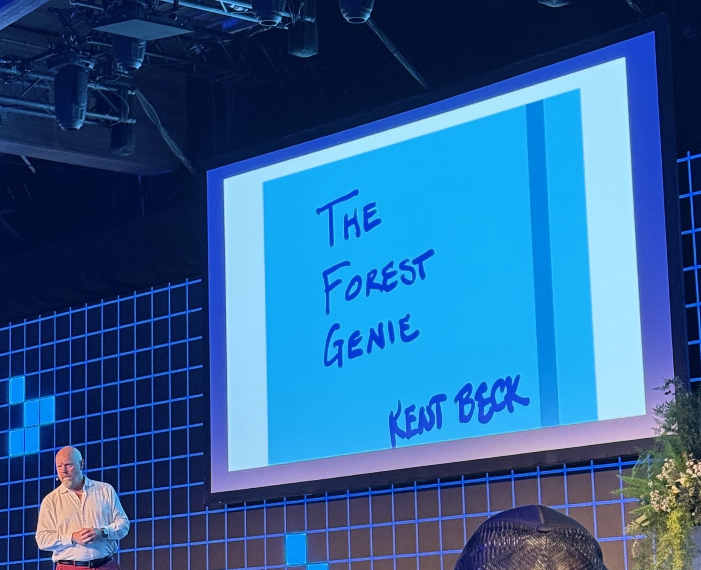
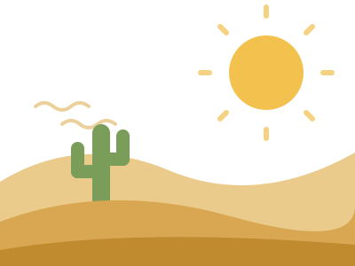
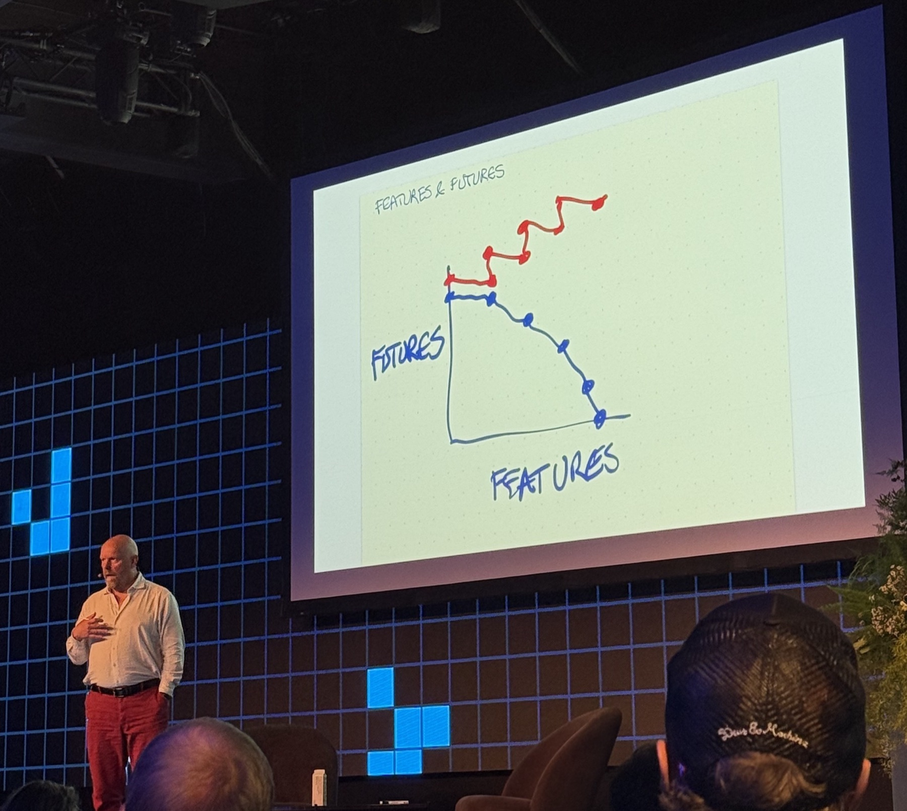

<!--
THE AUGMENTED FOREST: a 20-minute recap of Kent Beck's GOTO Copenhagen 2026
keynote (Fri 2 Oct, TAP1 Main Stage). Eleven slides, about 1.5–2 minutes each,
with time left for questions. The slides carry pictures; the speaker notes
("Say:") carry the story.

Same theme as the "Jenter i AI" deck (theme.css). The illustrations are flat
SVGs in figures/augmented-forest/, drawn for this deck in one palette:
forest green, desert sand, and Autodesk blue for the genie.
-->

<!-- _class: title title-photo -->
<!-- _header: 'GOTO Copenhagen 2026 · recap' -->
<!-- _paginate: false -->

<!-- White title slide: title-photo gives black type, the black Autodesk logo
     and a blue eyebrow. --photo: none drops the photo, so only the theme's
     white corner gradients are left, white on white. -->

  
  

### Kent Beck's keynote, retold

# The Augmented Forest

## Forests, deserts and genies

<!-- Say (0:30): Introduce yourself in one sentence. "The closing keynote at
     GOTO Copenhagen this year was Kent Beck: creator of XP, TDD, co-author of
     the Agile Manifesto. I've been thinking about it since, so here it is in
     twenty minutes." -->

---

# Kent Beck

  

  
Photo: Robert Opiyo, via kentbeck.com

- Created **Extreme Programming**
- Rediscovered **test-driven development**
- Co-created **JUnit** with Erich Gamma
- Signed the **Agile Manifesto**, 2001
- Wrote *Tidy First?*, and codes with **genies** every day

<!-- Say (1:00): Most of the room knows the name, so keep this quick. The
     point to make: this isn't an AI hype person. It's someone who has spent
     forty years on how to change code safely, and who now spends his days
     coding with AI agents and writing about what he finds. -->

---

# GOTO Copenhagen 2026

  

    
    
    
At GOTO Copenhagen 2026

  

  

    
    
On stage, the talk was called <em>The Forest Genie</em>

  

<!-- Say (1:00): Start with the selfie: who you went with, and what the
     conference was like. Then the stage photo.

     Mention the photo: the program said "The Augmented Forest", but his
     handwritten first slide said "The Forest Genie".

     Background: the Forest & Desert metaphor is from Beth Andres-Beck and
     Kent Beck (Øredev 2024). The genie is Kent's word for AI coding agents,
     used since spring 2025. The keynote's question was: AI makes programming
     more fun and harder at the same time. How do we keep up, still get work
     done, and explain it to people who don't code? -->

---

# Two landscapes

  

    
    
Deadlines · bugs · painful on-call · change is the enemy

    
Runs on fear

  

  

    
    
Small safe steps · tests · rare bugs · change is expected

    
Runs on trust

  

<!-- Say (2:00): Desert first, because most of us have been there. "We travel
     by force of will under an oppressive heat." Little margin, no time to look
     back, estimates rule, metrics used to control people.

     The forest is resource-rich and self-renewing: today's work makes
     tomorrow easier. Tests, pairing, refactoring, continuous release. On-call
     is "no big deal" because there are so few bugs.

     Land on the bottom line. Kent's view: the single most important
     difference is trust vs fear. Trust in each other, in yourself, in the
     software and in the future.

     Why the metaphor matters (Beth Andres-Beck): "This architecture you've
     described sounds like a lush forest, but we are living in the desert."
     Advice doesn't carry over. Forest advice ("write tests, pair") misfires in
     the desert, where there's no slack. Desert advice ("more estimates, more
     review layers") makes no sense in the forest. Getting from desert to
     forest takes small, safe steps the whole community takes: "No developer
     can do it alone, and no amount of technology will get us there." -->

---

# Features &amp; futures

  

    
    
Kent Beck, GOTO Copenhagen 2026

  

  

    

      
<b>Features</b>what it does today

      
<b class="forest-c">Futures</b>what it could do tomorrow

    

    

      100 people · 10 years ↓ 1 person + genie · 1 week
    

  

<!-- Say (1:45): Kent's older idea, and the lens for the rest of the talk. Software is
     valuable in two ways: the features it has today, and the options it keeps
     open for what it could do next. Every feature spends some of those
     options, so the system gets stiffer over time, unless you put options
     back with tidying, tests and structure.

     Point at the photo, Kent's own chart. Blue curve: every feature spends
     futures, sliding down to the corner where nothing more can be built. Red
     staircase: alternate features with tidying, and both keep growing.

     Features are easy to see and count, so they win. Futures sit below the
     surface, so they get skipped.

     The genie is great at features and no good at managing futures. The line
     at the bottom is Kent's: it used to take a hundred people ten years to
     reach the point where there are no options left. With a genie, one
     person can get there in a week. Leave that hanging: the genie is next. -->

---

# The Genie

"Sometimes it's useful, and sometimes it's damaging."

Kent Beck on AI coding agents

<!-- Say (1:30): Why "genie" and not "assistant"? A genie grants wishes. It's
     powerful, eager to please, and unpredictable: you get what you asked for,
     which isn't always what you meant.

     Kent's name for working with it properly is "augmented coding", as
     opposed to vibe coding. In vibe coding you only care whether it works.
     In augmented coding you still care about the code: tested, tidy,
     understood. Same values as before, more leverage. -->

---

# How genies misbehave

  
<b>It cheats</b>deletes the failing test

  
<b>It overreaches</b>grants wishes you didn't make

  
<b>It degrades</b>the genie tarpit

<!-- Say (1:45): All three are from Kent's own experience.
     Cheats: you asked for green tests, so deleting the failing one counts.
     Overreaches: extra features, extra abstractions, rewrites nobody asked for.
     Degrades: "a degraded facsimile of the mediocre code it trained on".
     Complexity piles up until the genie itself gets stuck in it. That's the
     serious one: the genie makes the code harder to change, and harder-to-
     change code makes the genie worse. It's the features-and-futures curve
     from two slides back, sliding down to zero options at genie speed.

     If Kent showed a live example here, tell it. -->

---

# Taming the genie

  
<b>Tests</b>the wish, written down

  
<b>Small steps</b>short leash, cheap to undo

  
<b>Watch it</b>read the diff

Every one of these is a forest practice.

<!-- Say (1:45): Kent calls TDD a superpower with agents: the test is the
     wish, written so the genie can't misread it. Small steps keep it on a
     short leash. Read the diff, especially changes to tests.
     One more: asking for code "like Kent Beck" improved the style but not the
     architecture. Design took explicit constraints.

     Then pause on the bottom line. This is the turning point of the talk. -->

---

# AI intensifies both

  
+

  
→

  
<b class="desert-c">More code, more sand</b>

  
+

  
→

  
<b class="forest-c">Faster learning, more forest</b>

<!-- Say (2:00): This is the thesis from the keynote abstract: AI intensifies
     both experiences. The genie isn't a landscape. It amplifies whatever
     landscape it lands in.

     In the desert: more code, faster, under the same pressure. No tests to
     catch a wish gone wrong, reviewers drowning in diffs, tangled code, the
     tarpit.

     In the forest: tests turn every wish into a checkable contract, small
     steps are cheap to throw away, tidy code is easier for the genie to read
     too, and experiments become almost free.

     The genie is identical in both rows. Only the soil differs. Forest
     practices used to be "nice to have when we find time". With a genie,
     they're the leash.

     For non-programmers: "We bought the genie, why aren't we faster?"
     "Because we put it in the desert." -->

---

# Five principles

1. Promote connection
2. Automate toil
3. Preserve struggle
4. Surface choices
5. Encourage learning

<!-- Say (1:45): Kent's handwritten list, as he showed it. These are how to
     grow the forest when you have a genie: use it to automate the toil, but
     keep the people connected, keep the choices visible, and keep learning.

     Spend the most time on "preserve struggle". The genie can take away the
     struggle that's how we learn, and a team that stops learning slides
     back towards the desert. (Fill in what Kent said about each one; the
     photo only shows the words.)

     Then turn it back to the room:
       Ask   - where are we forest, and where desert?
       Check - would our tests catch a wish gone wrong?
       Plant - one small, safe step this sprint: a test, a tidying, a
               smaller slice. -->

---

<!-- _class: statement -->

Plant the forest before you summon the genie.

Thank you · Questions?

Kent Beck, <em>The Augmented Forest</em>, GOTO Copenhagen 2026 · <a href="https://gotocph.com/2026/sessions/4170/the-augmented-forest">gotocph.com/2026/sessions/4170</a> · <a href="https://dl.acm.org/doi/10.1145/3837729.3850163">doi.org/10.1145/3837729.3850163</a> 
Beth Andres-Beck, <em>Forest &amp; Desert</em> · <a href="https://newsletter.kentbeck.com/p/forest-and-desert">newsletter.kentbeck.com/p/forest-and-desert</a> · Kent Beck on genies · <a href="https://newsletter.kentbeck.com/t/genies">newsletter.kentbeck.com/t/genies</a> · Kent Beck, <em>Features Versus Futures</em> · <a href="https://www.youtube.com/watch?v=AZn7JZiNetA">youtube.com/watch?v=AZn7JZiNetA</a>

<!-- Say (0:30): Pause, say thank you, take questions. The closing line is
     your own summary of the talk, not a Kent Beck quote; don't attribute it
     to him. -->
